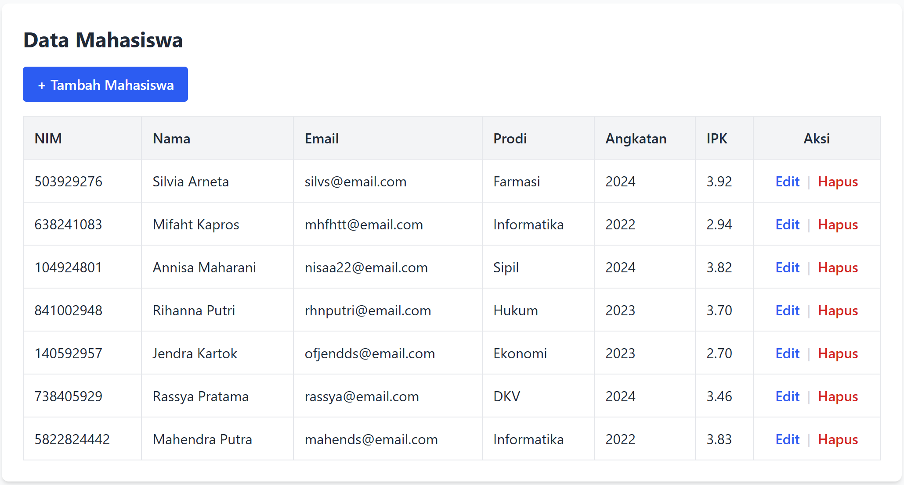
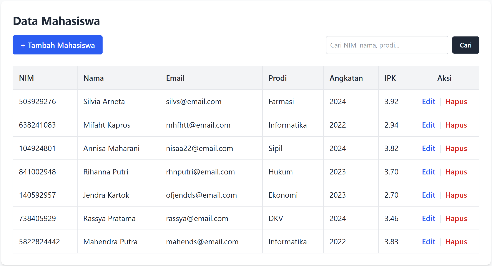
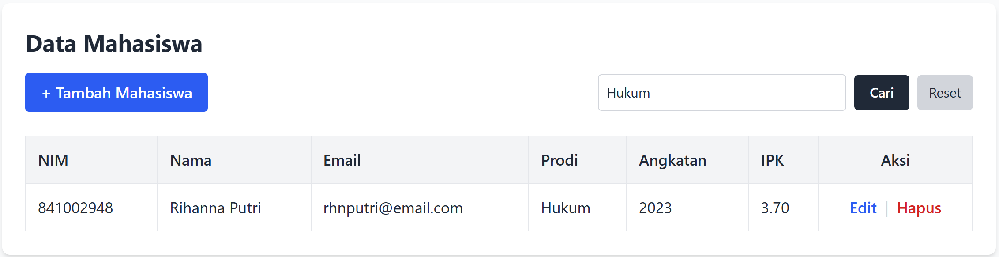
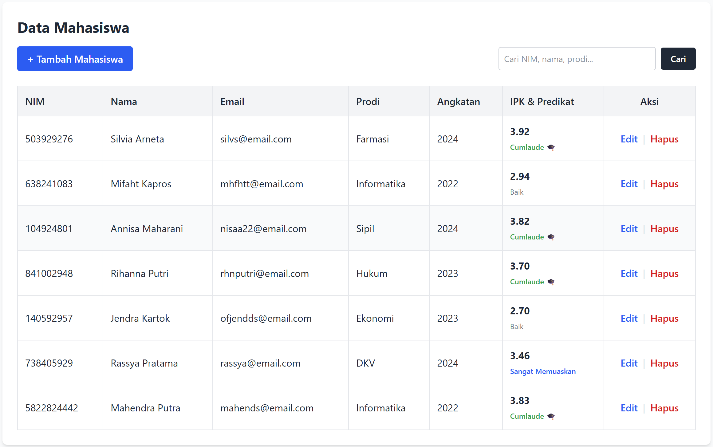

## 📌 Tugas 6 — Pertemuan 6 (Database `akademik3`)

Nama: Az-Zahra Putri

NPM: 4524210018

Mata Kuliah: Prak. Pemrograman Berbasis Web

--- 
### 1. Menjalankan Contoh Pertemuan 6
Aplikasi web CRUD (Create, Read, Update, Delete) berbasis PHP diintegrasikan dengan database `akademik3` melalui server lokal Laragon. Alur eksekusi dilakukan via browser melalui URL `http://localhost:8080/prak-pbw-b-az-zahra-putri-4524210018/pertemuan-6/index.php` dengan urutan: `index.php` (tabel data & pencarian) ➡️ `create.php` & `store.php` (tambah data) ➡️ `edit.php` & `update.php` (ubah data) ➡️ `delete.php` (hapus data).

### 2. Modifikasi yang Dilakukan
1. **Fitur Pencarian/Filter Data (di `index.php`)** — Menambahkan form pencarian berbasis string dinamis menggunakan metode `GET` untuk menyaring data mahasiswa berdasarkan NIM, nama, atau program studi secara spesifik.
2. **Logika Predikat Kelulusan IPK Otomatis (di `index.php`)** — Menambahkan pengkondisian `if-else` untuk mengkategorikan dan menampilkan label predikat kelulusan (seperti *Cumlaude*, *Sangat Memuaskan*, atau *Baik*) secara otomatis berdasarkan besaran nilai IPK mahasiswa pada tabel utama.

### 3. Penjelasan 5 Bagian Kode Terpenting
| No | Bagian Kode | Penjelasan |
|----|-------------|------------|
| 1 | `include "koneksi.php";` | Mengimpor file konfigurasi koneksi database sehingga variabel `$koneksi` dapat digunakan untuk mengeksekusi query SQL pada file terkait. |
| 2 | `mysqli_connect($host, $user, $pass, $db, $port);` | Membuka koneksi baru ke server MySQL menggunakan kredensial host, username, password, nama database target (`akademik3`), dan port 3306 Laragon. |
| 3 | `$_GET['cari']` | Mengambil kata kunci pencarian yang dikirimkan oleh pengguna melalui metode HTTP GET pada form pencarian di halaman utama. |
| 4 | `mysqli_query($koneksi, $query);` | Menjalankan instruksi/query SQL (seperti `INSERT`, `SELECT` dengan kondisi `LIKE`, `UPDATE`, atau `DELETE`) pada database `akademik3`. |
| 5 | `if ($ipk >= 3.50) { ... }` | Logika percabangan kondisional untuk menentukan dan merender label predikat IPK mahasiswa secara dinamis pada baris tabel data. |

### 4. Screenshot Sebelum & Sesudah Modifikasi

#### Modifikasi 1 : Fitur Pencarian Data Mahasiswa pada Halaman Utama
**Sebelum:**


**Sesudah:**



#### Modifikasi 2 : Penambahan Label Predikat Kelulusan IPK Otomatis
**Sebelum:**


**Sesudah:**


### 5. Error yang Pernah Muncul
- **Error:**
```text
  Fatal error: Uncaught mysqli_sql_exception: Table 'akademik3.mahasiswa' doesn't exist
```
- **Penyebab:** Database akademik3 berhasil terhubung, namun tabel mahasiswa di dalamnya belum dibuat .
- **Perbaikan:** Membuat struktur tabel mahasiswa (dengan kolom nim, nama, email, prodi, angkatan, dan ipk) secara manual melalui menjalankan skrip pembuatan tabel.