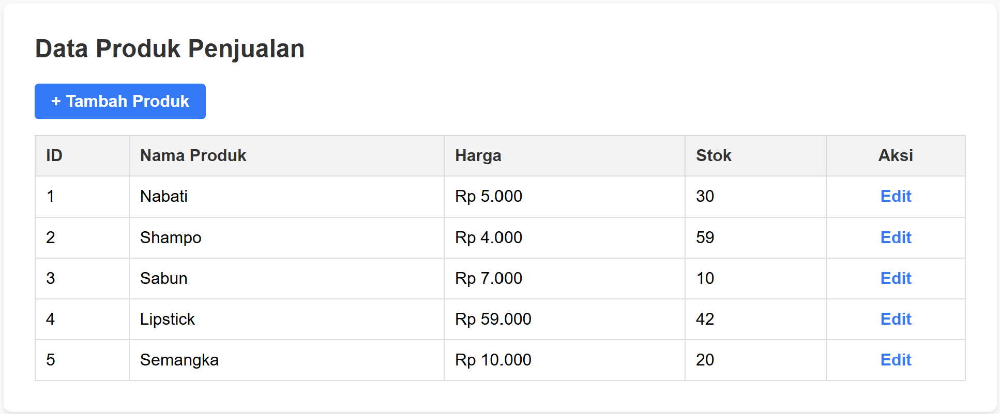
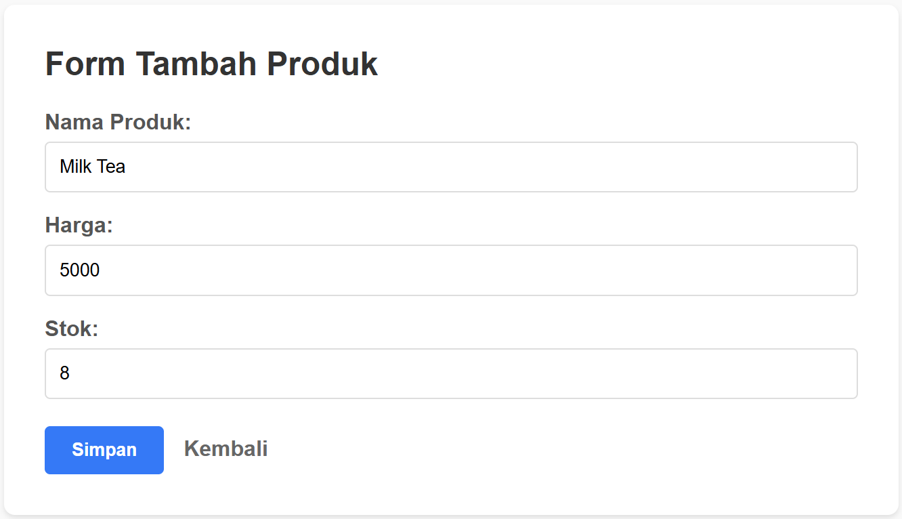
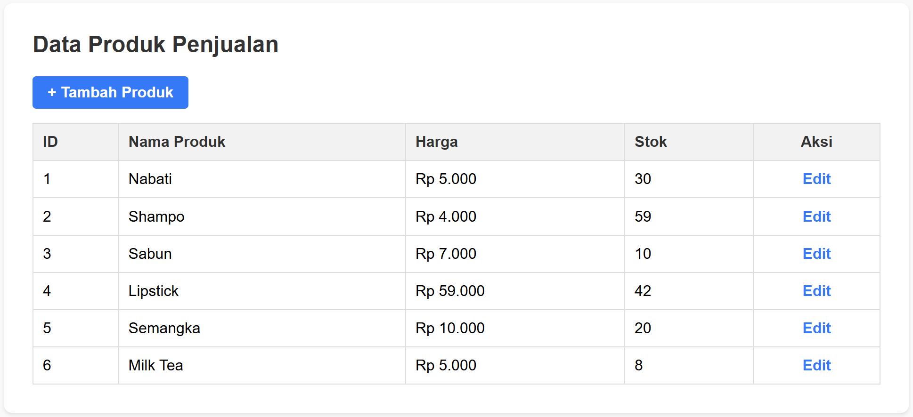
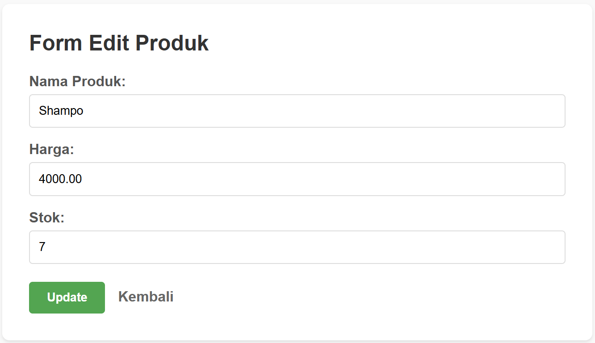
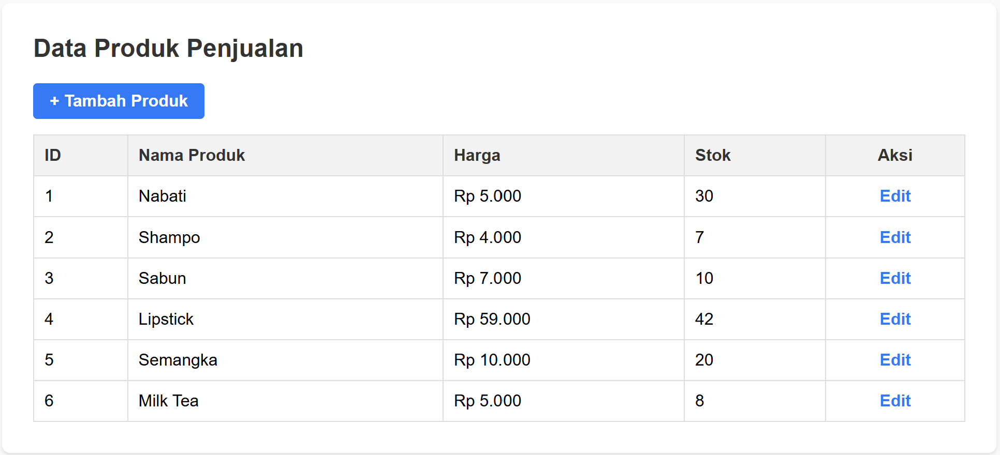

## 📌 Tugas 7 — Pertemuan 7 (Database `penjualan`, Arsitektur MVC)

Nama: Az-Zahra Putri

NPM: 4524210018

Mata Kuliah: Prak. Pemrograman Berbasis Web

--- 
### 1. Konsep Arsitektur MVC
Aplikasi web CRUD ini dikembangkan menggunakan arsitektur **MVC (Model-View-Controller)** yang memisahkan aplikasi menjadi tiga komponen utama agar kode lebih terstruktur dan mudah dikelola:
- **Model (`ProdukModel.php`)**: Bertanggung jawab penuh dalam menangani interaksi dengan database `penjualan` (seperti mengambil atau memanipulasi data produk).
- **View (`views/produk/`)**: Berfungsi sebagai antarmuka pengguna yang menampilkan data, form tambah, dan form edit ke layar browser.
- **Controller (`ProdukController.php`)**: Sebagai penghubung (jembatan) yang menerima permintaan dari pengguna melalui file utama, memanggil Model untuk mengambil data, lalu meneruskannya ke View.

---
### 2. Penjelasan 5 Bagian Kode Terpenting
| No | Bagian Kode | Penjelasan |
|----|-------------|------------|
| 1 | `class ProdukController` | Kelas pengontrol yang menjembatani komunikasi antara Model (pengambil data) dan View (tampilan antarmuka). |
| 2 | `class ProdukModel` | Kelas yang berisi kumpulan fungsi query database (seperti pengambilan seluruh data produk) agar terisolasi dari file tampilan. |
| 3 | `mysqli_real_escape_string()` | Fungsi pengamanan input teks pada proses input/form guna mencegah error sintaks SQL akibat karakter khusus seperti tanda kutip. |
| 4 | `number_format($harga, 0, ',', '.')` | Fungsi pemformatan angka agar harga produk tampil rapi dengan format mata uang rupiah (contoh: Rp 5.000). |
| 5 | `include "../../koneksi.php";` | Mengimpor file konfigurasi database dari direktori utama ke dalam sub-folder views agar koneksi tetap terhubung. |

---
### 3. Screenshot Hasil Program
#### Halaman Utama (Daftar Produk)
* Menampilkan tabel daftar produk lengkap dengan tombol aksi dan informasi harga yang terformat rapi.

#### Form Tambah & Edit Produk
* Menampilkan antarmuka form interaktif untuk menambah data baru serta memperbarui data produk yang sudah ada di database.
* Form Tambah Produk:

* Form Edit Produk:

